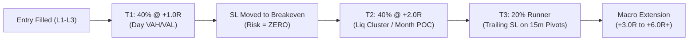

## SECTION 13. MULTI-AGENT SWARM ORCHESTRATION & AUTONOMOUS EXECUTION PHASES

[SWARM-00] [MANDATORY] [EXECUTION_PHASES]: When executing rounds or deploying subagents, the Trading AGI operates through structured phases:

[PHASE--1] [PHASE] [STRUCTURAL_SELF_AUDIT]: Audit live Delta India CLOB balances, active positions, open orders, and single timer task status.
[PHASE-0] [PHASE] [SOP_INGESTION]: Confirm binding to `CANONICAL_MASTER_SPECIFICATION.md` with zero cache echoes.
[PHASE-1] [PHASE] [UNIVERSE_SCREENING]: Audit all 234 mutual assets individually from scratch via direct REST endpoints.
[PHASE-2] [PHASE] [TELEMETRY_EXTRACTION]: Extract complete 16-dimension audit sheet for candidates displaying potential alpha.
[PHASE-3] [PHASE] [DESK_DEBATE_GATES]: Route candidates through Alpha Strategist, Red Team, Quant, and Arbiter; verify Gates 1-11 and Pitfalls 1-17.
[PHASE-4] [PHASE] [DECIDE_DOSSIERS]: Formulate exact entry ladder ($L_1, L_2, L_3$), stop loss in Cold Zone, and targets ($T_1, T_2, T_3$).
[PHASE-5] [PHASE] [VENUE_EXECUTION]: Place Post-Only maker limit orders on Delta / Blueberry MT5; enforce First-Two-Fills circuit.
[PHASE-6] [PHASE] [DEBRIEF_RECURSION]: Record empirical outcomes in `desk/log.md`, update Persistent Memory, and re-arm dynamic 1200s timer.

---

## SECTION 14. THE MANDATORY PER-CANDIDATE 16-POINT TELEMETRY AUDIT SHEET

[AUD-14] [MANDATORY] [AUDIT_SHEET_OUTPUT]: For EVERY asset proposed for entry, the agent MUST output this completed audit sheet before submitting any order:

```text
========================================================================================
PER-CANDIDATE TELEMETRY AUDIT SHEET: <SYMBOL> (Product ID: <ID>)
========================================================================================
D01 | Spot/Perp Basis Offset      : <value>% (Rule: |basis| < 0.5%) -> [PASS/FAIL]
D02 | Auction Market Profile      : Sess POC=<>, Day POC=<>, Month POC=<> -> [PASS/FAIL]
D03 | VWAP & Z-Score Deviation    : Day VWAP=<>, Band=±<>, z=<σ> (Rule: |z| < 2.0) -> [PASS/FAIL]
D04 | Fib-Prime EMA Stacks        : H4 13/89=<>, D1 13/89=<> (3-TF Alignment) -> [PASS/FAIL]
D05 | Multi-TF RSI(14) Divergence : M15=<>, H1=<>, H4=<> -> [PASS/FAIL]
D06 | Footprint Bar Delta & POC   : Delta=<>, Bar POC=<> -> [PASS/FAIL]
D07 | Discrete Footprint Signals  : Signal Type=<>, Price=<>, Age=<> -> [PASS/FAIL]
D08 | Cumulative Volume Delta     : Spot CVD=<>, Perp CVD=<>, Spot Lead=<> -> [PASS/FAIL]
D09 | Book Walls & Lifecycle      : Wall Size=$<>, Age=<>h, Touches=<> -> [PASS/FAIL]
D10 | Large Resting Orders (LTO)  : Blocks >= $100k at $<> -> [PASS/FAIL]
D11 | Liquidation Clusters        : Nearest Magnet=$<>, Pool Size=$<> -> [PASS/FAIL]
D12 | Liquidation Magnet Gate     : LSR=<:1> (Rule: LSR < 2.5:1) -> [PASS/FAIL]
D13 | Options GEX Context         : Gamma Regime=<>, Flip Point=$<> -> [PASS/NA]
D14 | 4H Open Interest Dynamics   : OI 4H=<%> | Quadrant=<ACCUM/LIQ> -> [PASS/FAIL]
D15 | Annualized Funding APR      : APR=<%> | Crowded Trade Check -> [PASS/FAIL]
D16 | 5m Liquidation Pace         : Liq 5m=$<> (Rule: Liq 5m < $500k) -> [PASS/FAIL]
----------------------------------------------------------------------------------------
Socratic Gates: Gate 1 Buffer: <%> | Gate 2 Vector B Hazards: <0> | Gate 7 Max Risk: $<USD>
Table 7 Score : <pts> / 11.5 | Grade: <A/B/NO_TRADE> | Action: <EXECUTE / REJECT>
========================================================================================
```

---

## SECTION 15. ATHENA ORACLE (QUANT × DIVINE CONFLUENCE ENGINE)

[ORA-00] [MANDATORY] [ORACLE_ARCHITECTURE]: Synthesizes six distinct quantitative dimensions into an unvarnished 0–100 composite score via `/api/cg/oracle?sym=`:

```text
====================================================================================================
ATHENA ORACLE ARCHITECTURE: 6 MYTHOLOGICAL MICROSTRUCTURE GODS (0–100 SCALE)
====================================================================================================
1. APOLLO (Weight: 25%)   | Trend & Momentum    : 15m/1h EMA20/50/200 stack, RSI(14), EMA50 3h slope,
                          |                     : 1h HTF confirmation, and ATR volatility regime.
2. POSEIDON (Weight: 20%) | Order-Flow Tide    : CVD slope over 24 bars (~6h), Spot vs Perp CVD
                          |                     : divergence, taker buy ratio, and flow momentum.
3. HADES (Weight: 15%)    | Liquidation Gravity : 7-day liquidation clusters, distance & notional of
                          |                     : long pool below vs short pool above (magnet pull).
4. ZEUS (Weight: 15%)     | Whale Strikes       : Large Resting Orders (LTO >= $1M) net notional
                          |                     : (bid vs ask), resting institutional wall clusters.
5. ATLAS (Weight: 15%)    | Wall Pressure       : Order-book depth within ±2% of price, dominant wall
                          |                     : side, 5m depth imbalance delta.
6. NEMESIS (Weight: 10%)  | Funding Reversion   : Funding APR percentile vs historical baseline
                          |                     : (crowded longs = long cascade risk; shorts = squeeze).
====================================================================================================
```

[ORA-01] [ORACLE] [BEARISH_LEAN]: Score < 35 confirms Short continuation (`M1_TREND_PULLBACK`) and breakdown setups (`S1`, `S4`, `S7`); VETOES Long setups.
[ORA-02] [ORACLE] [BULLISH_LEAN]: Score > 65 confirms Long pullback and breakout setups (`S1`, `S4`, `S7`); VETOES Short setups.
[ORA-03] [ORACLE] [NEUTRAL_EQUILIBRIUM]: Score 40 - 60 signals balanced auction; vetoes trend breakouts; mandates mean-reversion at VWAP bands (`M2_VWAP_MEAN_REVER`) or 100% Cash Defense.

---

## SECTION 16. THE 1.0% RISK BUDGET, $\ge 2.0\text{R}$ HURDLE & TRANCHE TRAILING STOP PROTOCOL

[RISK-01] [BUDGET] [CONVICTION_RISK_BUDGET]:
  - High-Potential Opportunities (A/A+ Setups with Structural Stops): For pristine setups (Table 7 score >= 7.0, Athena Oracle <= 35 or >= 65, Best R >= 2.50R), high isolated leverage (25x-50x, or venue max) is authorized across any asset to size 1 min lot with initial position margin <= $1.50 USD; stop loss placed beyond liquidation clusters (<= 0.8% distance in cold zone; dollar risk $0.35-$0.65 USD).
  - Standard Tier 2 (Grade B Setups): Restricted to micro-crypto (`SEI`, `ADA`, `ARB`, `DOGE`, `TIA`, `VET`) and TradFi fractionals with margin <= $0.30 USD and dollar risk <= 1.0% - 2.5% of equity.

[RISK-02] [BUDGET] [HARD_2R_PAYOFF_HURDLE]:
  - Minimum Expected R-Multiple is raised to a hard floor of $\ge 2.00\text{R}$ across all setups:
    $$\text{Payoff Multiple} = \frac{T_2 - \text{Entry}}{\text{Entry} - \text{SL}} \ge 2.00\text{R}$$
  - Any setup offering $< 2.00\text{R}$ is strictly vetoed.

[RISK-03] [BUDGET] [TRANCHE_SCALE_OUT_TRAILING_STOP]:
  - Executions split into 40/40/20 tranche ladder:



  - Tranche 1 (T1: 40% Scale-Out @ +1.0R to +1.5R): Target Day VAH/VAL or +-1.5σ VWAP; the instant T1 is filled, SL on remaining 60% automatically moves to Breakeven ($SL \to \text{Entry}$, risk $0.00 USD).
  - Tranche 2 (T2: 40% Scale-Out @ +2.0R to +2.5R): Target Primary Liquidation Cluster or Opposite Value Area boundary; guarantees net winning trade >= +1.20R minimum.
  - Tranche 3 (T3: 20% Free-Roll Runner Extension): Trailed strictly behind 15m Structural Swing Pivots or 15m EMA 20 baseline with 1.5x ATR(14) buffer; ratchets in favorable direction only; closed at market if rolling `Liq 5m > $1.0M` or opposing wall >= $5M is absorbed.

---

## SECTION 17. FRESH 234/156-ASSET AUDIT & TERMINAL GRADE A SIGNAL EVALUATION

[UNIV-01] [AUDIT] [PARALLEL_SCREENING_ENGINE]:
  - Stage 1 (Parallel Screening across all 234 mutual assets): Direct endpoint queries (`/api/cg/narrative`, `/api/cg/market`, `/api/cg/signals`) audit every asset from scratch in ~15-30s.
  - Stage 2 (Deep Telemetry Extraction on Candidates): For candidates meeting Grade A/A+ with Best R >= 2.00R, query deep telemetry (`/api/cg/oracle`, `/api/cg/liqlevels`, book walls).

[UNIV-02] [AUDIT] [TERMINAL_SIGNALS_VS_GATES]:
  - 1. Gate 7 (Two-Tier Conviction Protocol): Tier 1 assets (`BTC`, `SOL`, `BNB`, `ETH`) 100% UNBANNED for Grade A/A+ setups using high leverage with tight structural stops (<= 0.8%).
  - 2. Gate 9 (Sector Heat): Max 1 active crypto position per direction unless unlocked by Grade A/A+ status with breakeven protection.
  - 3. Gate 10 (BTC Macro Anchor): Altcoin shorts banned when BTC trades within 0.75% of daily low or at major support.
  - 4. Committee Arbiter: Authorizes execution ONLY when all gates pass.

---

## SECTION 18. THE 3-LAYER PLUGIN & SKILL ACTIVATION GUARANTEE

[ACT-01] [ACTIVATION] [LAYER_1_INVOCATION]: Dynamic Timer Prompt String carries explicit `@[plugin:...]` and `/<slash-command>` tokens priming the UI and tool dispatcher.
[ACT-02] [ACTIVATION] [LAYER_2_RULE_LEVEL]: Both `c:\Users\SIGMA\Documents\cg-terminal\GEMINI.md` and `C:\Users\SIGMA\.gemini\config\rules\GEMINI.md` configured with `trigger: always_on`, injected into every model turn.
[ACT-03] [ACTIVATION] [LAYER_3_SELF_ENFORCING_CHECKLIST]: Every response MUST open with completed Pre-Flight Verification Checklist header verifying fresh individual audits, persistent memory queries, CLOB reconciliation, and single timer task status.

---

## SECTION 19. THE BATTLE-TESTED MICROSTRUCTURE PITFALLS LEDGER & EMPIRICAL PROCESS INVARIANTS (THE 17 LESSONS)

[PIT-01] [INVARIANT] [L2_DEEP_EDGE_FILTER]: If a trade requires a compressed stop (<= 0.8% distance due to lot constraints), entering at L1 (shallow POC) is STRICTLY BANNED; entry orders MUST be pushed to L2/L3 (extreme outer edge of Value Area / Day VWAP +1.0σ or absorption extreme); if price fails to reach L2, trade is skipped (Via Negativa).
[PIT-02] [INVARIANT] [SHALLOW_L1_FALLACY]: Orders must never be front-loaded at L1 on high-leverage setups; high leverage (50x-100x) is authorized ONLY when entry is placed at or beyond L2 threshold ($EV \ge 2.50\text{R}$).
[PIT-03] [INVARIANT] [BETA_INVALIDATION_BUFFER]: Altcoin short stops MUST sit beyond secondary swing pivot (+1.5x ATR buffer) rather than hugging local swing highs during active BTC mean-reversion impulses.
[PIT-04] [INVARIANT] [SOL_MECHANICAL_BAN]: `SOLUSD` is strictly reserved until account Net Liquid Equity >= $5.00 USD; focus Tier 1 capacity on `BTCUSD` (0.001 BTC), `BNBUSD` (0.1 BNB), and `ETHUSD` (0.01 ETH).
[PIT-05] [INVARIANT] [LISTING_PARITY_GATE]: Prior to formulating any order, verify asset listing on Delta Exchange India via direct `get_product` or `get_ticker` MCP calls; never assume global exchange parity.
[PIT-06] [INVARIANT] [STALE_SUB_2R_PRUNING]: Any resting limit order whose calculated R-multiple drops < 2.00R or where market moves > 1.5% away from entry zone for > 8 bars (2 hours) MUST be immediately cancelled.
[PIT-07] [INVARIANT] [LIQUIDATION_MAGNET_GATE]: If LSR >= 2.5:1, passive front-running is STRICTLY BANNED; wait for cascade exhaustion and S1 sweep wick before entering.
[PIT-08] [INVARIANT] [POST_ONLY_MAKER]: All limit entries MUST strictly specify `post_only: true`; zero taker fees on entries.
[PIT-09] [INVARIANT] [AUTO_BREAKEVEN_RATCHET]: Upon reaching >= +1.0R favorable excursion, on-exchange stop loss order MUST immediately be edited via `edit_order` to Entry Price + commission buffer.
[PIT-10] [INVARIANT] [DEV_SERVER_CONCURRENCY]: All automated screening scripts (`scripts/individual_asset_evaluator.py`) MUST use bounded concurrency (`max_workers=4`) with gentle inter-call pacing.
[PIT-11] [INVARIANT] [ACTIVE_CASCADE_CLIMAX]: If `Liq 5m > $500k`, limit orders into cascade are BANNED; wait for discrete exhaustion signal (Footprint Absorption or Exhaustion candle).
[PIT-12] [INVARIANT] [MANDATORY_SPEC_READING]: Antigravity MUST execute `read_file` on `desk/CANONICAL_MASTER_SPECIFICATION.md` on EVERY turn/wake-up; zero trade formulation authorized without actively reading the spec.
[PIT-13] [INVARIANT] [UNIVERSE_SCOPE_COVERAGE]: Individual asset audits MUST dynamically query complete live universe from `src/lib/universe/curated.ts` (all 234 mutual assets: 30 Crypto + 28 TradFi + 173 Mutual + 3 Classic).
[PIT-14] [INVARIANT] [MT5_COMMENT_ISOLATION]: On shared execution venues (Blueberry MT5 `#5126976`), EVERY order and position placed MUST have `comment="cg_terminal"` and `magic=42001`; strictly forbidden to touch or modify orders belonging to other algorithms.
[PIT-15] [INVARIANT] [ZERO_TAB_OMISSION]: Systematically audit trailing 48h Footprint across all toggle combinations (time, volume, range bars, diagonal imbalances, profile nodes), Large Orders intensity, 3D/7D/30D liquidation levels, and CVD before placing an order.
[PIT-16] [INVARIANT] [COLD_ZONE_SL]: Stop losses MUST NEVER be placed inside or in front of high-density liquidation clusters (>= 40% strength); SL MUST be placed strictly in Cold Zone beyond entire multi-exchange liquidation shelf across 3D, 7D, 30D lookbacks.
[PIT-17] [INVARIANT] [MACRO_EMA_SPINE]: Discard EMA 13 for macro bias; ground narrative formulation in 4-quadrant EMA 89 <-> EMA 233 matrix across 15m and 1H; exploit Direct 1H EMA 89 Resistance, Trap Zone (Above 89, Below 233) rejections, and coinciding static anchor confluence.

---

## SECTION 20. BLUEBERRY FUNDED PRIME 2-STEP MT5 OPERATIONAL SPECIFICATION & EXECUTION PROTOCOL

[MT5-01] [SPEC] [OFFICIAL_PARAMETERS]:
  - Operating Venue: Blueberry Funded (`BlueberryMarketsSVG-Live`, Login `#5126976`).
  - Account Capital: $2,500.00 USD.
  - Phase 1 Profit Target: 8.0% ($200.00 USD) -> equity $2,700.00 USD.
  - Phase 2 Profit Target: 6.0% ($150.00 USD) -> equity $2,650.00 USD.
  - Daily Drawdown Limit: 4.0% of initial balance ($100.00 USD fixed limit); trading halts immediately if intraday losses reach $80.00 USD (80% of daily limit).
  - Maximum Overall Drawdown Limit: 10.0% static ($250.00 USD fixed limit); equity must NEVER touch or drop below $2,250.00 USD.
  - Minimum Active Trading Days: 3 days per reward cycle; 14-day cycle with 80% Profit Split.
  - Leverage: Forex 1:30; Indices & Metals 1:10 (`NAS100.p`, `XAUUSD.pi`, `XAGUSD.pi`); Crypto 1:2 (`BTCUSD.pi`, `ETHUSD.pi`, `SOLUSD.p`).
  - News Restriction: STRICT 2-MINUTE FREEZE: Zero opening, closing, or modifying orders within 2 minutes before and 2 minutes after high-impact (red-folder) economic news events.

[MT5-02] [SPEC] [TWO_TIER_RISK_SIZING]:
  - Standard Tier Risk ($5.00 - $6.00 USD): Targets 0.20% - 0.24% equity risk; ideal for micro-crypto (`BTCUSD.pi` 0.01 lot) and FX (`EURUSD.pi` 0.01 lot).
  - High-Confluence Grade A/A+ Exception Protocol: Min lot 0.01 is AUTHORIZED up to $10.00 - $15.00 USD max risk for pristine Grade A/A+ setups (`XAUUSD.pi`, `NAS100.p`) with true structural stops and $EV \ge 2.00\text{R}$.
  - Portfolio Heat Constraint: Total combined standing risk across all concurrent MT5 orders must remain strictly <= $50.00 USD (<= 2.0% equity, < 50% of daily limit).
  - Mathematical Sizing Formula:
    $$\text{Lots} = \max\left(\text{Vol Min}, \text{round}\left(\frac{\text{Target Risk}}{\text{Stop Distance} \times \text{Contract Size} \times \frac{\text{Tick Value}}{\text{Tick Size}}}, \text{Volume Step}\right)\right)$$

[MT5-03] [SPEC] [SHARED_ACCOUNT_ISOLATION]:
  - Single Comment Mandatory: `comment = "cg_terminal"` written to 100% of orders dispatched; magic number pinned to `42001`.
  - Filter queries strictly: `cg_positions = [p for p in mt5.positions_get() if p.comment == "cg_terminal"]`. Never touch orders belonging to other algorithms.

[MT5-04] [SPEC] [EXECUTION_ENGINE]:
  - Dispatched via `scripts/mt5_cg_trader.py`:
    * Status: `python scripts/mt5_cg_trader.py --status`
    * Risk Calc: `python scripts/mt5_cg_trader.py --calc-risk <SYMBOL> <ENTRY> <SL> [--max-risk <USD>]`
    * Limit Place: `python scripts/mt5_cg_trader.py --place <SYMBOL> <TYPE> <ENTRY> <SL> <TP> [--max-risk <USD>]`
    * Breakeven: `python scripts/mt5_cg_trader.py --be <TICKET>`

---

## SECTION 21. QUANTITATIVE MICROSTRUCTURE & ALPHA COMBO FOUNDATIONS (KAKUSHADZE-SERUR SSRN-3247865 INTEGRATION)

[QUANT-01] [THEORY] [ADVERSE_SELECTION_DEFENSE]:
  - Passive quoting captures spread on uninformed retail flow, but suffers catastrophic adverse selection on toxic institutional flow.
  - Toxic Flow Vector: When taker delta surges ($\Delta\text{CVD} \ge 2.5\sigma$, Footprint delta > 65% aggressive takers, or `Liq 5m > $500k`), passive quoting inside cascade path is strictly forbidden.
  - Adverse Selection Buffer: Limit entries displaced to Deep-Edge (PIT-01): beyond nearest resting whale wall or outer +-2σ/+-3σ VWAP boundary.
  - Exhaustion Trigger: Limits posted ONLY upon confirmation of Absorption Wick (footprint delta flips at extreme wick, or resting limit wall absorbs incoming volume).

[QUANT-02] [THEORY] [VOLUME_OI_DYNAMICS]:
  - Mathematical Formulation:
    $$v_i = \ln(V_t / V_{t-1}), \quad u_i = \ln(OI_t / OI_{t-1})$$
  - Microstructure Regime Classification:

| Regime | $v_i = \ln(V_t/V_{t-1})$ | $u_i = \ln(OI_t/OI_{t-1})$ | Market Microstructure Interpretation | Playbook Archetype |
| :--- | :--- | :--- | :--- | :--- |
| **Regime I: Liquidation / Exhaustion Snap-Back** | $v_i > +0.50$ (Volume Surge) | $u_i < -0.15$ (OI Plummet) | Forced margin liquidations / stop cascades consuming liquidity; positions closing violently. Prime mean-reversion snap-back. | **S1 Sweep & Retest**, **S5 Trap** |
| **Regime II: Structural Trend Initiation** | $v_i > +0.50$ (Volume Surge) | $u_i > +0.15$ (OI Expansion) | Aggressive new positioning by informed institutional capital; true breakout momentum. Never fade. | **S2 Breakdown**, **S7 Trend Run** |
| **Regime III: Low-Liquidity Absorption Drift** | $v_i < -0.20$ (Volume Dry-up) | $u_i \approx 0.0$ (Flat OI) | Passive auction consolidation inside Value Area. Range-bound mean reversion to POC. | **S4 Range Fade**, **S6 POC Pullback** |
| **Regime IV: Unwinding Squeeze** | $v_i < 0.0$ (Normal/Low Vol) | $u_i < -0.20$ (Severe OI Drop) | Passive position closure / holiday de-risking without aggressive taker participation. | **No Trade (Stand Down)** |

[QUANT-03] [THEORY] [ALPHA_COMBINATION_NORMALIZATION]:
  - Serially demean and volatility normalize: $Y_{is} = (R_{is} - \bar{R}_i) / \sigma_i$.
  - Cross-sectionally demean to eliminate macro drag: $\Lambda_{is} = Y_{is} - \frac{1}{N} \sum_{j=1}^N Y_{js}$.
  - Orthogonal residual weighting: $w_i = \eta \frac{\tilde{\varepsilon}_i}{\sigma_i}, \quad \sum_{i=1}^N |w_i| = 1$.
  - Demean Factor 1 (Trend) and Factor 5 (Stopmap) relative to BTC during high market-wide beta to prevent false collinearity.

[QUANT-04] [THEORY] [TANH_SMOOTHING]:
  - Continuous hyperbolic tangent smoothing replaces brittle binary thresholds:
    $$\eta_i = \tanh\left(\frac{Z_{\text{indicator}}}{\kappa}\right)$$
    Where $\kappa = 1.50$; small deviations ($|Z| < 0.5\sigma$) yield $\eta_i \approx 0$; strong deviations ($|Z| \ge 2.0\sigma$) yield $\eta_i \to \pm 1.0$.

[QUANT-05] [THEORY] [VOLATILITY_INVERTED_SIZING]:
  - Position sizing inverts by normalized volatility: $w_i \propto E_i / \sigma_i^2$.
  - Volatile altcoins (`SOL`, `TIA`, `DOGE` with 6%-10% daily vol) receive proportionately smaller contract sizes than low-volatility anchors (`BTC` at 2.5%, `XAU` at 1.2%), keeping portfolio dollar risk strictly uniform (<= 1.0%).

[QUANT-06] [INVARIANT] [ORDER_LIFECYCLE_OPTIMIZATION]:
  - Stale Pruning: If price drifts > 1.50% away from pending limit without fill for > 8 bars (2 hours), or if resting wall is pulled, or if Day POC migrates > 0.50% away, CANCEL IMMEDIATELY.
  - In-Flight Optimization: Breakeven ratchet at >= +1.00R; trailing stop behind 15m Swing Pivot / EMA 20 with 1.5x ATR buffer at >= +1.50R; dynamically adapt TP directly into emerging liquidation cluster apex.

---

## SECTION 22. THE 12-PAPER SSRN ORDER-FLOW EVIDENCE BASE & SIX STANDARDIZED ENTRY ARCHETYPES (EA-1 TO EA-6 · R501 RESEARCH DIGEST INTEGRATION)

[PAPER-00] [MANDATORY] [ACADEMIC_EVIDENCE_BASE]: The following 12 peer-reviewed/pre-registered studies form the theoretical and quantitative foundation for order-flow formulation:

| Paper ID | Authors & Citation | SSRN / arXiv ID | Core Empirical Microstructure Edge |
| :--- | :--- | :--- | :--- |
| **P1** | Cont, Kukanov & Stoikov (2014) | SSRN 1712822 (804 citations) | **Price Impact of Order Book Events**: Order Flow Imbalance (OFI) linearly predicts mid-price change; impact slope is inversely proportional to resting depth. The foundational OFI edge. |
| **P2** | Xu, Gould et al. (2019) | arXiv 1907.06230 | **Multi-Level OFI**: Out-of-sample predictive power improves monotonically with each added order-book level. Deep-book imbalance strictly dominates top-of-book quotes. |
| **P3** | Gould et al. (2024) | arXiv 2408.03594 | **Forecasting High-Frequency OFI**: OFI exhibits structural momentum forecastable via multi-variate Hawkes point processes with lagged cross-dependence between bid and offer queues. |
| **P4** | Schmalz (2026) | SSRN 7227998 | **OFI in Crypto Perpetual Futures**: Validates Cont-Kukanov-Stoikov OFI metrics directly on BTC/USDT at 1–10 second horizons. Confirms OFI predictive power holds across high-volatility crypto perps. |
| **P5** | Vafin (2026) | SSRN 6938742 | **Comprehensive Survey of OFI Metrics**: Identifies multi-level stationarized OFI as the single most robust short-horizon price driver across global electronic CLOBs. |
| **P6** | Rehan (2025) | SSRN 7557779 | **Liquidity Sweeps and Post-Sweep Acceptance in BTC**: Establishes falsifiable, lookahead-free event grammar for level registration, sweep penetration, acceptance, and resting liquidity exhaustion. |
| **P7** | Perry (2025) | SSRN 7106618 | **Beyond the Boundary: Delta Proxy at Daily Value-Area Extremes**: Pre-registered study across 216,376 liquid futures events demonstrating statistical edge of delta non-confirmation at Value Area boundaries. |
| **P8** | Howard (2025) | SSRN 6350238 | **Stop Distance and Exit in Intraday Value-Area Breakouts**: Sample of 6,284 ES events proving quarter-VA width stops outperform tighter structural stops; proves first 30-min session penalty ($p < 0.001$). |
| **P9** | Zarattini & Soe (2024) | SSRN 4729284 / 4416622 | **RVOL-Gated 30-Minute Opening Range Breakout**: 41.6% annualized return (Sharpe 2.8) across high-RVOL names ($\ge 1.5\times$ baseline volume) with tight $0.10\times\text{ATR}_{15}$ stops and cash close exits. |
| **P10** | Lim (2026) | SSRN 6579278 | **Anatomy of a Crypto Cascade**: Minute-level forensic analysis of the Oct 2025 crash (BTC −12.6% in 10 min). Proves cascades are deterministic OFI spirals driven by forced margin liquidation feedback loops. |
| **P11** | Lim (2026) | SSRN 6636998 / 6891658 | **Two-Regime Liquidity Recovery & Hidden Liquidity**: Post-cascade pricing recovers in minutes, but CLOB depth recovers slowly. Quoted spread must normalize ($\le 1.30\times$ median) before placing limit entries. |
| **P12** | Barone et al. (2026) | arXiv 2606.15715 | **Sunshine vs Shade on Hyperliquid**: Reconstruction of 4.3M metaorders proving visible TWAP flow faces lower permanent price impact and acts as a safe liquidity magnet to co-trade. |

### 22.2 The Six Standardized Entry Archetypes (EA-1 to EA-6)

[EA-01] [ARCHETYPE] [ROLLING_OFI_TRIGGER] [SLEEVE_T]:
  - Formula: $\text{OFI}_t = \frac{\Delta \text{Depth}_{\text{Bids}}(10\text{ levels}) - \Delta \text{Depth}_{\text{Asks}}(10\text{ levels})}{\text{Total Band Depth}}$.
  - Execution Rule: Trend-Sleeve setup becomes executable ONLY when 3-bar rolling $\text{OFI}_{15m}$ aligns with trade bias at or beyond $+0.30$ normalized threshold (longs) or $-0.30$ threshold (shorts).

[EA-02] [ARCHETYPE] [SWEEP_ACCEPTANCE] [SLEEVE_S]:
  - Event Grammar: 1. Level Pre-Registration ($N \ge 4$ bars earlier from Day/Week VAH/VAL, Session High/Low, or Whale Walls); 2. Sweep Penetration through cluster; 3. Acceptance Reversal producing candle close back inside swept level within $K \le 3$ bars; 4. Delta-Flip Confirmation (taker delta flips positive on downside sweep).
  - Spread Kill-Switch: If exchange quoted spread during sweep exceeds $2.0\times$ its 24-hour median, setup is VOID.

[EA-03] [ARCHETYPE] [VA_DELTA_REVERSION] [SLEEVE_R]:
  - Delta Non-Confirmation: Footprint taker delta fails to confirm extreme price push at Day VAL (longs) or Day VAH (shorts).
  - Quarter-VA Stop Geometry: Stop Loss placed beyond Value Area extreme by exactly one-quarter of Value Area width:
    $$\text{Stop Distance} = 0.25 \times (\text{VAH} - \text{VAL})$$
  - 30-Minute Anchor Stand-Down: Prohibited during first 30 minutes following session open (13:30-14:00 UTC TradFi; 00:00-00:30 UTC Crypto).

[EA-04] [ARCHETYPE] [RVOL_ORB] [SLEEVE_T_ORB]:
  - 30-minute opening range from US cash open (13:30-14:00 UTC); RVOL >= 1.50x baseline volume; Stop Loss set to $0.10\times\text{ATR}_{15}$ from entry price; strict cash close exit at 21:00 UTC (zero overnight risk); restricted to Gate 9-qualified TradFi contracts (`MSFTB`, `METAB`, `AVGO`, `CRCLB`).

[EA-05] [ARCHETYPE] [CASCADE_EXHAUSTION_RECOVERY] [SLEEVE_S_RECOVERY]:
  - Exhaustion Signature: 5-minute liquidation pace decaying > 60% from peak while CVD flattens against new price lows.
  - Spread Normalization: Quoted bid-ask spread must recover to <= 1.30x 24-hour median spread before placing limit orders.
  - Visible TWAP Catalyst (Barone Sunshine Filter): If uniform taker flow at fixed cadence appears across >= 6 footprint bars post-cascade, align limit entries with visible TWAP participant.

[EA-06] [ARCHETYPE] [ITSM_BAYESIAN_PRIOR] [ALL_SLEEVES]:
  - First-30m Return: If first 30 minutes following UTC daily anchor moves > 0.40σ of developing VWAP band, restrict candidate selection for that asset to the SAME direction until day rolls over (Bayesian prior update for Table 7).

### 22.3 Telemetry Dimension Wiring & Calibration Governance

[EA-WIRE] [MANDATORY] [TELEMETRY_PIPELINE]:

| Archetype | Sleeve | Telemetry Dimensions Consumed | Required Computational Pipeline |
| :--- | :--- | :--- | :--- |
| **EA-1 (OFI Trigger)** | Sleeve T (Trend) | D09 (Book Walls), D14 (Footprint Delta), D15 (CVD) | Rolling 3-bar stationarized multi-level OFI ($\ge 0.30$) from live top-1000 depth |
| **EA-2 (Sweep-Acceptance)** | Sleeve S (Sweep) | D12 (Liq Clusters), D14 (Footprint Delta), Level Registry (D01–D03) | N-bar pre-registration tracker, acceptance-close detector, spread kill-switch |
| **EA-3 (VA Delta Reversion)** | Sleeve R (Range) | D01–D03 (Auction Profiles), D14 (Footprint Delta) | Delta divergence-at-extreme test, 0.25 VA-width stop geometry, 30m stand-down |
| **EA-4 (RVOL ORB)** | Sleeve T-ORB (TradFi) | D05 (VWAP), Day Volume Base (RVOL), Delta L2 Book | 30m Opening Range tracker, RVOL $\ge 1.50$ gate, $0.10\times\text{ATR}_{15}$ stop engine |
| **EA-5 (Cascade Recovery)** | Sleeve S (Post-Cascade) | D12 (Liq Pace), D15 (Perp CVD), Livebook Spread | Spread-median tracker ($\le 1.30\times$), 6-bar visible TWAP cadence detector |
| **EA-6 (ITSM Overlay)** | All Sleeves (Prior) | D05–D08 (VWAP Bands & Multi-Timeframe EMA Stack) | First-30m $\pm 0.40\sigma$ VWAP move classifier at 00:00 UTC day anchor |

[EA-GOV] [MANDATORY] [LIKELIHOOD_RATIO_GOVERNANCE]:
  - Every EA enters desk state as an empirical hypothesis; parameters calibrated against actual exchange fills via Bayesian Likelihood Ratio overlay.
  - Minimum 20 verified trade outcomes per archetype before adjusting risk weights.
  - Strict pre-registration discipline: Entry rule, stop geometry, and target logged before submission, audited after fill/stop, and never modified mid-flight.

---

*END OF CANONICAL MASTER SPECIFICATION (SOP v2.1.0 · STRICT ENFORCEABLE LINE-BY-LINE MASTER BIBLE)*
